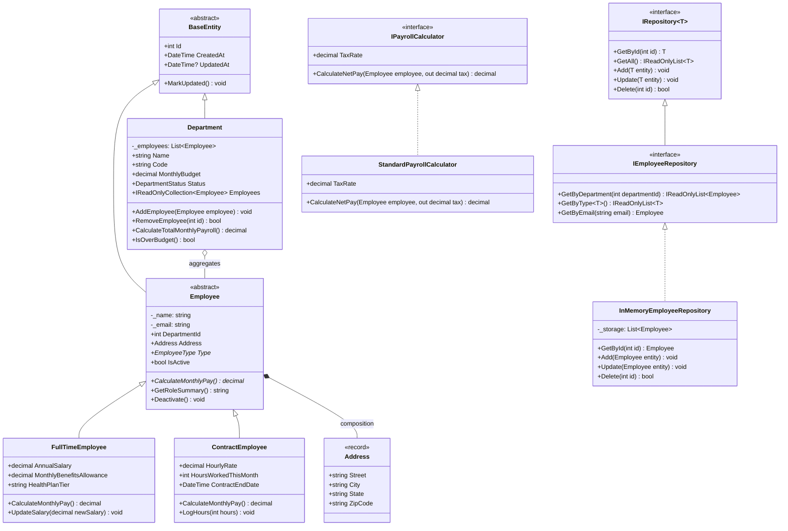

# Day 2: Object-Oriented C#, Enterprise Abstractions & SOLID Principles

## Overview
This project fulfills the **Day 2 Training Deliverables** of the .NET Engineering Bridge program. It introduces an enterprise-grade domain class library (`EmployeeManagement.Domain`), modeling core entities with clean encapsulation, inheritance hierarchies, polymorphic pay calculations, interface-based abstractions, repository patterns, and SOLID design principles.

---

## Deliverables Checklist
- [x] Domain model class library (`EmployeeManagement.Domain`) with core entities.
- [x] Abstract base classes: `BaseEntity` and `Employee`.
- [x] Derived polymorphic entities: `FullTimeEmployee` and `ContractEmployee`.
- [x] Aggregation & Invariant Encapsulation: `Department`.
- [x] Modern C# Record: `Address` (demonstrating value equality and `with` expressions).
- [x] Interface-based design: `IRepository<T>`, `IEmployeeRepository`, and `IPayrollCalculator`.
- [x] Concrete implementations: `InMemoryEmployeeRepository` and `StandardPayrollCalculator`.
- [x] Class relationship diagram (Mermaid UML below).
- [x] Comprehensive SOLID explanation with code references.
- [x] Day 2 LeetCode Solution: **1342. Number of Steps to Reduce a Number to Zero**.
- [x] Interview preparation Q&A.

---

## Class Relationship Diagram (UML)



---

## SOLID Principles in This Solution

### 1. Single Responsibility Principle (SRP)
> *"A class should have one, and only one, reason to change."*
- **In our code:**
  - `Employee` models employee state and data validity. It does **not** handle how taxes are calculated or how records are stored in memory or a database.
  - `StandardPayrollCalculator` is exclusively responsible for applying tax deductions and net pay calculations.
  - `InMemoryEmployeeRepository` is solely responsible for storage and retrieval operations.

### 2. Open/Closed Principle (OCP)
> *"Software entities should be open for extension, but closed for modification."*
- **In our code:**
  - When a new employment arrangement is introduced (e.g. `CommissionEmployee` or `InternEmployee`), we simply derive a new class from `Employee` and implement `CalculateMonthlyPay()`.
  - We do **not** have to modify existing calculation methods, repository methods, or write new `switch (employee.Type)` statements!

### 3. Liskov Substitution Principle (LSP)
> *"Objects of a superclass should be replaceable with objects of its subclasses without breaking application correctness."*
- **In our code:**
  - Any method expecting an `Employee` (such as `Department.AddEmployee(Employee employee)` or `calculator.CalculateNetPay(Employee employee, ...)`) works flawlessly whether you pass a `FullTimeEmployee` or a `ContractEmployee`.
  - Subclasses honor the contract without throwing unexpected `NotSupportedException` or altering base class invariants.

### 4. Interface Segregation Principle (ISP)
> *"Clients should not be forced to depend upon interfaces that they do not use."*
- **In our code:**
  - Instead of a monolithic "God Interface" (`IEmployeeManager` with persistence, payroll, HR, and email methods), we split responsibilities into focused contracts:
    - `IRepository<T>` (CRUD persistence)
    - `IEmployeeRepository` (employee querying)
    - `IPayrollCalculator` (tax & pay calculation)

### 5. Dependency Inversion Principle (DIP)
> *"High-level modules should not depend on low-level modules. Both should depend on abstractions."*
- **In our code:**
  - High-level business consumers (`OopAndSolidDemo` and future controllers) depend on `IEmployeeRepository` and `IPayrollCalculator` rather than the concrete `InMemoryEmployeeRepository` or `StandardPayrollCalculator`.
  - When we switch to SQL Server EF Core on Day 9, the domain logic will not change—only the repository implementation will be swapped!

---

## Key OOP Comparisons

### Composition vs. Inheritance

| Aspect | Inheritance ("is-a") | Composition ("has-a") |
| :--- | :--- | :--- |
| **Relationship** | `FullTimeEmployee` **is an** `Employee`. | `Department` **has** a list of `Employee`s; `Employee` **has an** `Address`. |
| **Coupling** | High (derived class tightly coupled to base class implementation). | Low (components can be swapped or modified independently). |
| **Flexibility** | Rigid compile-time hierarchy; cannot change base class at runtime. | Dynamic; behavior can be changed at runtime by injecting different components. |
| **Best Practice** | Use sparingly for true polymorphic domain contracts. | Prefer composition as the default architectural design choice. |

### Interface vs. Abstract Class

| Feature | Interface (`interface`) | Abstract Class (`abstract class`) |
| :--- | :--- | :--- |
| **Purpose** | Defines a contract ("what" a type can do). | Defines a partial blueprint and shared identity ("what" a type is). |
| **State** | Cannot declare instance fields. | Can maintain instance fields, constructors, and state. |
| **Multiple Inheritance**| A class can implement multiple interfaces (`IEmployeeRepository, IDisposable`). | A class can inherit from only ONE base class. |
| **Speed & Usage** | Ideal for decoupling, test mocking, and cross-cutting capabilities. | Ideal for sharing common code and core polymorphic identity across a family of types. |

---

## LeetCode Problem Log: 1342. Number of Steps to Reduce a Number to Zero

- **Problem:** Return the number of steps to reduce `num` to zero. If `num` is even, divide by 2; if odd, subtract 1.
- **Approach:**
  - While `num > 0`:
    - Bitwise check `(num & 1) == 0` for even numbers: right-shift `num >>= 1` (equivalent to dividing by 2).
    - If odd: subtract 1.
    - Increment step counter.
- **Complexity:**
  - **Time Complexity:** $O(\log_2 N)$ — The value of $N$ is halved every 1 or 2 operations.
  - **Space Complexity:** $O(1)$ — Only a single integer counter is stored.
- **Edge Cases Tested:**
  1. `num = 0` $\rightarrow$ Returns `0` immediately.
  2. `num = 1` $\rightarrow$ 1 step (`1 -> 0`).
  3. `num = 14` $\rightarrow$ 6 steps (`14 -> 7 -> 6 -> 3 -> 2 -> 1 -> 0`).
  4. Powers of two (`num = 8`) $\rightarrow$ 4 steps (`8 -> 4 -> 2 -> 1 -> 0`).

---

## How to Run Day 2

### Run Automated Demos & Tests (Headless)
```powershell
dotnet run --project "D:\sai\dotnet\src\EmployeeManagement.ConsoleApp" -- --demo
```

### Run Interactive Menu (Option 6 runs Day 2 OOP Demos, Option 8 runs LeetCode 1342)
```powershell
dotnet run --project "D:\sai\dotnet\src\EmployeeManagement.ConsoleApp"
```
