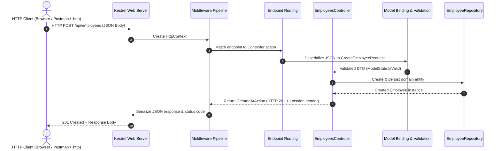

# Day 6: ASP.NET Core & RESTful Web API Fundamentals

## Overview
This project fulfills the **Day 6 Training Deliverables** of the .NET Engineering Bridge program (Week 2 Kickoff). It creates a dedicated ASP.NET Core Web API project (`EmployeeManagement.API`) establishing RESTful endpoints, model binding, DTO projections, HTTP status codes, Swagger/OpenAPI documentation, and automated API unit tests.

---

## Deliverables Checklist
- [x] Dedicated ASP.NET Core Web API project (`src/EmployeeManagement.API`) configured in the solution.
- [x] Full RESTful CRUD endpoints for `Employees` and `Departments`:
  - `GET /api/employees` (list all, supports filtering by department or minimum pay)
  - `GET /api/employees/{id}` (fetch by ID -> 200 OK or 404 NotFound)
  - `POST /api/employees` (create employee -> 201 Created with `Location` header)
  - `PUT /api/employees/{id}` (full update -> 204 NoContent or 400/404)
  - `PATCH /api/employees/{id}/salary` (partial update -> 200 OK)
  - `DELETE /api/employees/{id}` (delete -> 204 NoContent or 404)
  - `GET /api/departments/{id}/payroll` (department budget & payroll compliance report)
- [x] Strongly-typed Data Transfer Objects (DTOs) with DataAnnotation validations (`CreateEmployeeRequest`, `EmployeeResponse`, etc.).
- [x] OpenAPI / Swagger UI integration available at the application root (`/`).
- [x] Ready-to-use HTTP client requests file (`EmployeeManagement.API.http`) with success and failure test requests.
- [x] **58 Total Passing Unit Tests** (including 7 new API controller tests in `EmployeesControllerTests.cs`).

---

## ASP.NET Core Request Lifecycle



---

## HTTP Status Codes & When to Return Them

| Status Code | Reason / Meaning | Example in Our API |
| :---: | :--- | :--- |
| **`200 OK`** | Request succeeded and returned a payload. | `GET /api/employees` or `GET /api/employees/101`. |
| **`201 Created`**| A new resource was successfully created. **Must include a `Location` header** pointing to the new resource. | `POST /api/employees` returning `Location: /api/employees/201`. |
| **`204 No Content`**| Action succeeded, but there is no body to return. | `PUT /api/employees/101` and `DELETE /api/employees/102`. |
| **`400 Bad Request`**| Client sent invalid input (failed model validation, missing field, duplicate email). | `POST /api/employees` with empty name or negative salary. |
| **`404 Not Found`**| Requested resource does not exist. | `GET /api/employees/9999` or `DELETE /api/employees/9999`. |
| **`500 Server Error`**| Unhandled exception or unexpected server failure. | Server bug or database crash. |

---

## Technical Comparison: PUT vs. PATCH

| Characteristic | `PUT` (Full Replacement) | `PATCH` (Partial Update) |
| :--- | :--- | :--- |
| **Semantics** | Replaces the **entire** resource representation with the provided payload. | Modifies only the **specified fields/delta** of the existing resource. |
| **Missing Fields** | Any field omitted in the PUT body is typically set to its default/null value. | Omitted fields remain completely untouched. |
| **Idempotence** | **Strictly Idempotent:** Sending the same `PUT` request 10 times results in the exact same state. | Usually non-idempotent or conditionally idempotent. |
| **Example in API** | `PUT /api/employees/101` with complete updated object. | `PATCH /api/employees/101/salary` with `{ "newSalaryOrRate": 145000 }`. |

---

## How to Run & Test the API

### 1. Run the Web API
In PowerShell or terminal:
```powershell
dotnet run --project "D:\sai\dotnet\src\EmployeeManagement.API"
```

### 2. Open Swagger / OpenAPI Documentation
Open your browser and navigate to:
👉 **`http://localhost:5200`** (or the port displayed in your terminal output).

You will see an interactive dashboard where you can test every single endpoint (`GET`, `POST`, `PUT`, `PATCH`, `DELETE`) with one click!

### 3. Run Tests via VS Code REST Client (`.http`)
Open [`src/EmployeeManagement.API/EmployeeManagement.API.http`](file:///D:/sai/dotnet/src/EmployeeManagement.API/EmployeeManagement.API.http) in VS Code.
If you have the **REST Client** extension installed, click **"Send Request"** above any query to execute it instantly inside your editor!

### 4. Run All 58 Unit Tests
```powershell
dotnet test "D:\sai\dotnet\EmployeeManagement.sln"
```
