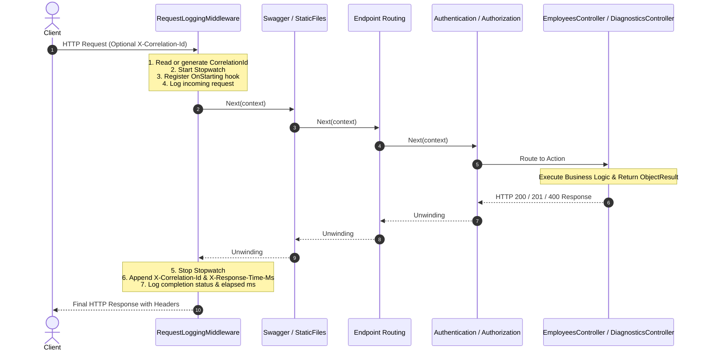

# Day 7: Dependency Injection Lifetimes & Custom Middleware

## 1. Overview & Learning Objectives

Day 7 focuses on the core architectural engine of ASP.NET Core: the **Dependency Injection (DI) Container** and the **HTTP Middleware Pipeline**. By understanding how services are resolved and how HTTP requests travel through middlewares, we construct maintainable, observable, and resilient web applications.

### Key Deliverables
- **Custom Request Logging Middleware (`RequestLoggingMiddleware`):**
  - Distributed tracing support via `X-Correlation-Id` header (propagates existing IDs or generates a new GUID).
  - Performance tracking with `X-Response-Time-Ms` header attached via `context.Response.OnStarting`.
  - Structured request/response logging with execution time and HTTP status codes.
- **Service Lifetimes Demonstration (`IOperationService` & `OperationService`):**
  - Clear separation of `IOperationTransient`, `IOperationScoped`, and `IOperationSingleton`.
  - Visual verification endpoint `GET /api/diagnostics/lifetimes`.
- **Options Pattern (`PayrollSettings`):**
  - Strongly-typed configuration mapped from `appsettings.json` using `IOptions<PayrollSettings>`.
  - Inspection endpoint `GET /api/diagnostics/configuration`.
- **Automated Test Coverage:**
  - 4 xUnit tests verifying DI lifetimes across scopes.
  - 2 xUnit tests verifying middleware header attachment and correlation propagation.
  - Total test suite: **64 / 64 passing**.

---

## 2. The ASP.NET Core Middleware Pipeline

ASP.NET Core processes HTTP requests using a sequence of delegates known as the **Middleware Pipeline**. Middlewares execute in a bidirectional "Russian doll" model: each component inspects/transforms the incoming request, calls `await _next(context)`, and then inspects/transforms the outgoing response on the unwinding path.

### Pipeline Flow Diagram



### Critical Middleware Design Pattern: `context.Response.OnStarting`
In ASP.NET Core, response headers cannot be modified once the response body begins streaming to the client (`context.Response.HasStarted == true`). Calling `context.Response.Headers.Add(...)` after `await _next(context)` can throw an `InvalidOperationException` if a downstream controller or middleware has started writing to the response stream.

`RequestLoggingMiddleware` registers a callback using `context.Response.OnStarting(...)` to ensure custom headers are reliably appended right before HTTP response bytes are flushed:

```csharp
context.Response.OnStarting(() =>
{
    stopwatch.Stop();
    context.Response.Headers[CorrelationIdHeader] = correlationId;
    context.Response.Headers[ResponseTimeHeader] = stopwatch.ElapsedMilliseconds.ToString();
    return Task.CompletedTask;
});
```

---

## 3. Dependency Injection (DI) Lifetimes

The built-in .NET IoC container manages the lifecycle and disposal of registered dependencies. Choosing the correct lifetime prevents memory leaks, thread contention, and data inconsistencies.

| Lifetime | Registration Method | Instantiation Frequency | Typical Use Cases |
| :--- | :--- | :--- | :--- |
| **Transient** | `services.AddTransient<T, U>()` | Every single time requested (`new` instance per resolution) | Lightweight, stateless utilities, formatters, pure calculators |
| **Scoped** | `services.AddScoped<T, U>()` | Once per HTTP Request (shared within the request scope) | EF Core `DbContext`, Unit of Work, Business Services, Repositories |
| **Singleton** | `services.AddSingleton<T, U>()` | Once per Application lifetime (shared across all requests & threads) | Caches, background queues, configuration classes, state aggregators |

### The Captive Dependency Anti-Pattern
A **Captive Dependency** occurs when a service with a longer lifetime consumes a service with a shorter lifetime (e.g., a **Singleton** service injecting a **Scoped** `DbContext`):

```csharp
// ANTI-PATTERN: Singleton holding Scoped dependency captive
public class CacheService // Registered as Singleton
{
    private readonly EmployeeManagementDbContext _db; // Scoped!
    public CacheService(EmployeeManagementDbContext db) { _db = db; }
}
```

#### Why Captive Dependencies are Dangerous:
1. **Concurrency Exceptions:** `DbContext` is not thread-safe. Multiple simultaneous HTTP requests calling methods on the singleton will access the same `DbContext` instance concurrently, throwing `InvalidOperationException`.
2. **Memory Leaks:** The `DbContext` change tracker will accumulate tracked entities indefinitely for the entire lifetime of the process.
3. **Stale Data:** Cached entities inside the DbContext will never be reloaded, leading to silent business logic bugs.

#### Prevention:
ASP.NET Core enables **Scope Validation** in the `Development` environment by default (`ValidateScopes = true`). When the application starts or a root service provider resolves a scoped service, an `InvalidOperationException` is thrown immediately, catching captive dependencies before deployment.

---

## 4. Strongly-Typed Configuration: The Options Pattern

Instead of reading raw configuration values with `_configuration["PayrollSettings:DefaultBonusRate"]`, ASP.NET Core provides the **Options Pattern** (`IOptions<T>`) for strongly-typed, type-safe settings:

```csharp
// Program.cs
builder.Services.Configure<PayrollSettings>(
    builder.Configuration.GetSection(PayrollSettings.SectionName));

// Consumed via constructor injection:
public class DiagnosticsController : ControllerBase
{
    private readonly PayrollSettings _settings;
    public DiagnosticsController(IOptions<PayrollSettings> options)
    {
        _settings = options.Value;
    }
}
```

### Options Variants:
- `IOptions<T>`: Singleton lifetime. Evaluated once at application startup. Zero per-request overhead; changes to `appsettings.json` require application restart.
- `IOptionsSnapshot<T>`: Scoped lifetime. Re-evaluates configuration per HTTP request. Supports real-time configuration reloading without restarting the process.
- `IOptionsMonitor<T>`: Singleton lifetime. Supports notifications (`OnChange`) when configuration changes on disk.

---

## 5. Live Diagnostics Endpoints

The API exposes endpoints under `/api/diagnostics` to inspect lifetimes and configuration at runtime:

### 1. `GET /api/diagnostics/lifetimes`
Demonstrates DI resolution by injecting two instances of each lifetime within a single request:
```json
{
  "transientInstances": {
    "instance1": "a1b2c3d4-...",
    "instance2": "e5f6a7b8-...",
    "areEqual": false,
    "explanation": "Transient instances are ALWAYS DIFFERENT (new instance per resolution)"
  },
  "scopedInstances": {
    "instance1": "7c9e6679-...",
    "instance2": "7c9e6679-...",
    "areEqual": true,
    "explanation": "Scoped instances are IDENTICAL within the same HTTP request"
  },
  "singletonInstances": {
    "instance1": "3f4211a0-...",
    "instance2": "3f4211a0-...",
    "areEqual": true,
    "explanation": "Singleton instances are IDENTICAL across all HTTP requests and users"
  }
}
```

### 2. `GET /api/diagnostics/configuration`
Returns the active payroll configuration bound from `appsettings.json`:
```json
{
  "source": "appsettings.json via IOptions<PayrollSettings>",
  "companyName": "Contoso Enterprise Solutions",
  "defaultBonusRate": 0.15,
  "minimumAnnualSalary": 35000.0,
  "overtimeMultiplier": 1.75,
  "autoApproveBenefits": true
}
```

---

## 6. Verification & Test Suite

The solution contains automated unit tests under `tests/EmployeeManagement.UnitTests/DiAndMiddlewareTests`:

- `ServiceLifetimeTests.cs`:
  - `TransientLifetime_EachResolution_ShouldProduceDistinctInstance`
  - `ScopedLifetime_WithinSameScope_ShouldProduceIdenticalInstance`
  - `ScopedLifetime_AcrossDifferentScopes_ShouldProduceDifferentInstances`
  - `SingletonLifetime_AcrossDifferentScopes_ShouldAlwaysProduceIdenticalInstance`
- `RequestLoggingMiddlewareTests.cs`:
  - `InvokeAsync_ShouldAttachCorrelationIdAndExecuteNext`
  - `InvokeAsync_PropagatesExistingCorrelationIdIfPresent`

```powershell
Passed!  - Failed:     0, Passed:    64, Skipped:     0, Total:    64, Duration: 2.83 s
```
