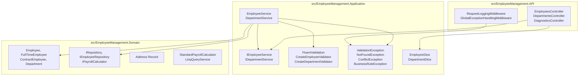

# Day 8: Layered Architecture, FluentValidation & Centralized Exception Handling

## 1. Overview & Learning Objectives

Day 8 transforms the application into an enterprise-grade **Layered (3-Tier / Clean) Architecture**. Business logic, input validation, and orchestration are removed from ASP.NET Core controllers and placed into a dedicated `EmployeeManagement.Application` layer. Controllers become **Thin Controllers**, request validation is decoupled using **FluentValidation**, and error handling is centralized using custom middleware implementing the **RFC 7807 ProblemDetails** standard.

### Key Deliverables
- **New Project: `EmployeeManagement.Application`:**
  - Class library targeting .NET 8.0, housing Application Services, Interfaces, DTOs, and Validators.
  - Extension method `services.AddApplication()` for clean DI registration.
- **Thin Controllers:**
  - `EmployeesController` and `DepartmentsController` delegate all business operations to `IEmployeeService` and `IDepartmentService`.
  - Zero `try-catch` boilerplate or business logic inside controllers.
- **FluentValidation Rules:**
  - `CreateEmployeeRequestValidator`, `UpdateEmployeeRequestValidator`, `PatchSalaryRequestValidator`, and `CreateDepartmentRequestValidator`.
  - Conditional validation based on employee type (Full-Time salary rules vs Contract hourly rate/hours rules).
  - Regex-based format validation for employee names, email domain extensions, and ZIP codes.
- **Centralized Global Exception Handling (`GlobalExceptionHandlingMiddleware`):**
  - Converts application exceptions into standardized RFC 7807 `application/problem+json` payloads.
  - Maps `ValidationException` -> 400 Bad Request (`ValidationProblemDetails` with field errors dictionary).
  - Maps `NotFoundException` -> 404 Not Found (`ProblemDetails`).
  - Maps `ConflictException` -> 409 Conflict (`ProblemDetails`).
  - Maps `BusinessRuleException` -> 422 Unprocessable Entity (`ProblemDetails`).
  - Maps unhandled exceptions -> 500 Internal Server Error with `X-Correlation-Id`.
- **Comprehensive Unit Testing Suite:**
  - 30 new unit tests added across validators, application services, and exception middleware.
  - **Total test suite: 94 / 94 tests passing**.

---

## 2. Layered Architecture & Dependency Flow

Clean Architecture enforces the **Dependency Rule**: inner layers know nothing about outer layers.



### Architectural Benefits
1. **Separation of Concerns:** Controllers only receive HTTP requests, parse DTOs, and return HTTP status codes. Business invariants belong in `Domain`, orchestration in `Application`.
2. **Framework Independence:** Core business services and validators have no dependency on ASP.NET Core MVC controllers or HTTP contexts.
3. **Testability:** `EmployeeService` can be tested in isolation using fast unit tests without spinning up HTTP test servers.

---

## 3. FluentValidation vs DataAnnotations

| Feature | DataAnnotations (`[Required]`, `[Range]`) | FluentValidation (`AbstractValidator<T>`) |
| :--- | :--- | :--- |
| **Separation of Concerns** | Clutters DTO classes with validation metadata | Keeps DTOs pure data structures; validation lives in separate classes |
| **Complex / Cross-Field Logic** | Requires cumbersome custom attributes | Native fluent syntax (`When(x => x.Type == EmployeeType.FullTime, ...)`) |
| **Reusability & DI** | Hard to inject external services (e.g., database checks) | First-class DI support; validators can inject repositories |
| **Unit Testing** | Requires validating via `Validator.TryValidateObject` | Dedicated testing library (`validator.TestValidate(dto).ShouldHaveValidationErrorFor(...)`) |

### Example: Conditional Validation in `CreateEmployeeRequestValidator`
```csharp
// Full-Time specific rules
When(x => x.Type == EmployeeType.FullTime, () =>
{
    RuleFor(x => x.SalaryOrHourlyRate)
        .GreaterThanOrEqualTo(20000m)
        .WithMessage("Full-time annual salary must be at least $20,000.");
});

// Contract specific rules
When(x => x.Type == EmployeeType.Contract, () =>
{
    RuleFor(x => x.SalaryOrHourlyRate)
        .InclusiveBetween(15m, 1000m)
        .WithMessage("Contract hourly rate must be between $15.00 and $1,000.00.");

    RuleFor(x => x.ContractHoursThisMonth)
        .InclusiveBetween(1, 744)
        .WithMessage("Contract hours worked this month must be between 1 and 744 hours.");
});
```

---

## 4. RFC 7807 ProblemDetails Standard

Instead of returning ad-hoc error formats (`{ "error": "something failed" }`), enterprise APIs standardize on **RFC 7807** (`application/problem+json`).

### 1. Validation Error Response (HTTP 400 Bad Request)
```json
{
  "errors": {
    "Name": [
      "Employee name is required."
    ],
    "Email": [
      "A valid email address is required.",
      "Email must have a valid domain extension (e.g., user@domain.com)."
    ],
    "DepartmentId": [
      "A valid positive DepartmentId is required."
    ]
  },
  "type": "https://tools.ietf.org/html/rfc7231#section-6.5.1",
  "title": "Validation Failure",
  "status": 400,
  "detail": "One or more validation failures have occurred.",
  "instance": "/api/employees",
  "correlationId": "4bf92f3577b34da6a3ce929d0e0e4736",
  "timestamp": "2026-11-21T14:45:00.1234567Z"
}
```

### 2. Conflict Error Response (HTTP 409 Conflict)
```json
{
  "type": "https://tools.ietf.org/html/rfc7231#section-6.5.8",
  "title": "Conflict",
  "status": 409,
  "detail": "An employee with email 'alice.johnson@company.com' already exists.",
  "instance": "/api/employees",
  "correlationId": "4bf92f3577b34da6a3ce929d0e0e4736",
  "timestamp": "2026-11-21T14:45:10.1234567Z"
}
```

### 3. Resource Not Found (HTTP 404 Not Found)
```json
{
  "type": "https://tools.ietf.org/html/rfc7231#section-6.5.4",
  "title": "Not Found",
  "status": 404,
  "detail": "Employee with identifier '9999' was not found.",
  "instance": "/api/employees/9999",
  "correlationId": "4bf92f3577b34da6a3ce929d0e0e4736",
  "timestamp": "2026-11-21T14:45:20.1234567Z"
}
```

---

## 5. Verification & Test Suite

The test suite expanded from 64 to **94 passing tests**:

- **`CreateEmployeeRequestValidatorTests` (11 tests):**
  - Full-time & Contract valid cases.
  - Name empty, invalid characters, length boundaries.
  - Email format and top-level domain extension checks.
  - Department ID positive range.
  - Salary floor & hourly rate boundaries.
  - Zip code regex format validation.
- **`EmployeeServiceTests` (8 tests):**
  - Creation, duplicate email conflict, validation failure.
  - ID retrieval and not found exception.
  - Full-time salary patch and Contract hourly rate patch.
  - Deletion success and not found exception.
- **`GlobalExceptionHandlingMiddlewareTests` (4 tests):**
  - 400 ValidationProblemDetails mapping.
  - 404 NotFound ProblemDetails mapping.
  - 409 Conflict ProblemDetails mapping.
  - 500 Unhandled Exception ProblemDetails mapping.
- **`EmployeesControllerTests` (7 async tests):**
  - Thin controller delegation to `IEmployeeService`.
  - HTTP 200, 201 CreatedAtAction, 204 NoContent, and exception propagation.

```powershell
Passed!  - Failed:     0, Passed:    94, Skipped:     0, Total:    94, Duration: 0.79 s
```
