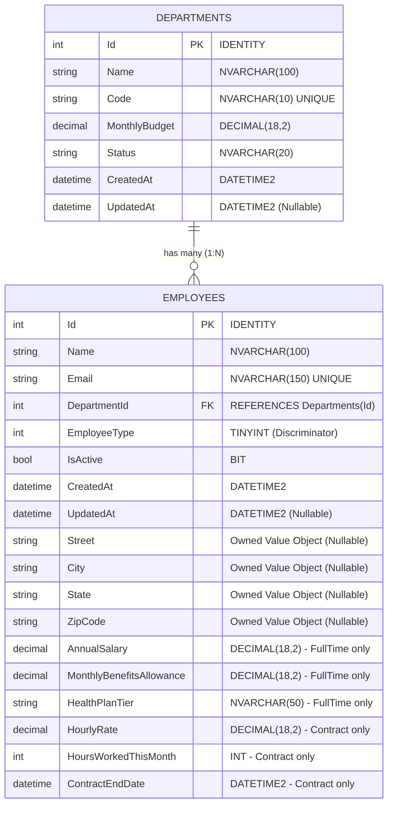

# Day 9: Entity Framework Core 8.0 & SQL Server Integration

## 1. Overview & Learning Objectives

Day 9 introduces persistent relational data storage to the Employee & Department Management System using **Entity Framework Core 8.0** and **Microsoft SQL Server**. In alignment with Clean Architecture principles, all database concerns, ORM configurations, migrations, and repository implementations are encapsulated within the **`EmployeeManagement.Infrastructure`** layer.

### Key Deliverables
- **New Project: `EmployeeManagement.Infrastructure`:**
  - Class library targeting .NET 8.0 containing `EmployeeManagementDbContext`, entity configurations, migrations, and SQL repositories.
  - Extension method `services.AddInfrastructure(configuration)` for modular service registration.
- **Relational Entity Mapping:**
  - **1-to-Many Relationship:** One `Department` has many `Employees`, with foreign key constraint `DepartmentId` and `DeleteBehavior.Restrict`.
  - **Encapsulated Collections:** Mapped private backing field `_employees` in `Department` to preserve domain invariants (`AddEmployee`, `RemoveEmployee`).
  - **Table-Per-Hierarchy (TPH) Inheritance:** Polymorphic `Employee` base entity with `FullTimeEmployee` and `ContractEmployee` mapped to a single `Employees` table using discriminator `EmployeeType`.
  - **Owned Value Object:** `Address` record mapped directly into the `Employees` table using `OwnsOne`.
- **Code-First Migrations:**
  - Generated `InitialCreate` migration using `dotnet-ef`.
  - `DatabaseSeeder` for populating initial departments and employees.
- **Performance & Query Optimization:**
  - `AsNoTracking()` applied to all read queries to bypass EF Core Change Tracker overhead.
  - Server-side filtering, multi-field sorting, and pagination via `GetPagedAsync` translating into SQL `OFFSET ... FETCH NEXT`.
- **Automated Testing Suite:**
  - 12 new unit tests in `InfrastructureTests` using EF Core `InMemory` provider.
  - **Total test suite: 106 / 106 unit tests passing**.

---

## 2. Entity Relationship & Database Schema



---

## 3. Advanced EF Core Modeling Techniques

### 1. Table-Per-Hierarchy (TPH) Inheritance
Rather than creating separate tables for full-time and contract employees (which requires SQL `JOIN`s for polymorphic queries), TPH stores all employees in a single table with an integer discriminator:

```csharp
// EmployeeConfiguration.cs
builder.HasDiscriminator<EmployeeType>("EmployeeType")
    .HasValue<FullTimeEmployee>(EmployeeType.FullTime)
    .HasValue<ContractEmployee>(EmployeeType.Contract);
```

### 2. Encapsulated Collection with Private Backing Field
In domain-driven design, entities protect their invariants by exposing `IReadOnlyCollection<T>` rather than a mutable `List<T>`. EF Core accesses the private `_employees` field directly:

```csharp
// Department.cs
private readonly List<Employee> _employees = new();
public IReadOnlyCollection<Employee> Employees => _employees.AsReadOnly();

// DepartmentConfiguration.cs
builder.Navigation(d => d.Employees)
    .UsePropertyAccessMode(PropertyAccessMode.Field);
```

### 3. Owned Value Object (`Address`)
The `Address` record has no independent identity; it belongs to an `Employee`. Using `OwnsOne`, its properties are flattened into the `Employees` table:

```csharp
builder.OwnsOne(e => e.Address, a =>
{
    a.Property(p => p.Street).HasColumnName("Street").HasMaxLength(200);
    a.Property(p => p.City).HasColumnName("City").HasMaxLength(100);
    a.Property(p => p.State).HasColumnName("State").HasMaxLength(50);
    a.Property(p => p.ZipCode).HasColumnName("ZipCode").HasMaxLength(20);
});
```

---

## 4. Query Performance: Tracking vs `AsNoTracking()`

| Aspect | Change Tracking (Default) | `AsNoTracking()` |
| :--- | :--- | :--- |
| **Memory Allocation** | Allocates snapshot copies of each entity in the `ChangeTracker` | Zero snapshot overhead; instances garbage collected after request |
| **CPU Overhead** | High (tracks property mutations and resolves identity map) | Minimal (straight SQL deserialization) |
| **When to Use** | `Add()`, `Update()`, `Delete()`, state mutation workflows | Read queries, reports, API `GET` endpoints, paginated grids |

```csharp
// In SqlEmployeeRepository.cs: Read queries always use AsNoTracking()
public IReadOnlyList<Employee> GetAll()
{
    return _context.Employees
        .Include(e => e.Department)
        .AsNoTracking()
        .ToList();
}
```

---

## 5. Server-Side Pagination, Filtering & Sorting

Instead of pulling thousands of records into web server memory and filtering with LINQ-to-Objects, `SqlEmployeeRepository.GetPagedAsync` builds an expression tree executed on the SQL Server instance:

```csharp
// Translates into: SELECT ... FROM Employees ORDER BY Name OFFSET @p0 ROWS FETCH NEXT @p1 ROWS ONLY
var items = await query
    .Skip((pagination.PageNumber - 1) * pagination.PageSize)
    .Take(pagination.PageSize)
    .ToListAsync(cancellationToken);
```

### API Endpoint: `GET /api/employees/paged`
```
GET /api/employees/paged?pageNumber=1&pageSize=5&sortBy=name&sortDirection=asc&departmentId=1
```

Response payload (`PagedResult<EmployeeResponse>`):
```json
{
  "items": [
    {
      "id": 1,
      "name": "Alice Johnson",
      "email": "alice.johnson@company.com",
      "departmentId": 1,
      "type": "FullTime",
      "monthlyPay": 10800.0,
      "city": "Seattle",
      "isActive": true,
      "createdAt": "2026-11-21T14:50:00Z"
    }
  ],
  "totalCount": 3,
  "pageNumber": 1,
  "pageSize": 5,
  "totalPages": 1,
  "hasPreviousPage": false,
  "hasNextPage": false
}
```

---

## 6. Verification & Test Suite

The test suite expanded from 94 to **106 passing tests**:

- **`SqlEmployeeRepositoryTests` (11 tests):**
  - Read queries (`GetAll`, `GetById`, `GetByEmail`, `GetByDepartment`, `GetByType`).
  - Mutations (`Add`, `Update`, `Delete`).
  - Server-side pagination (`GetPagedAsync` page limits, total counts, next/prev page flags).
  - Search term filtering across names and emails.
- **`DepartmentRelationshipTests` (1 test):**
  - Verifies 1-to-many relationship hydration and child collection persistence across DbContext boundaries.

```powershell
Passed!  - Failed:     0, Passed:   106, Skipped:     0, Total:   106, Duration: 1.28 s
```
