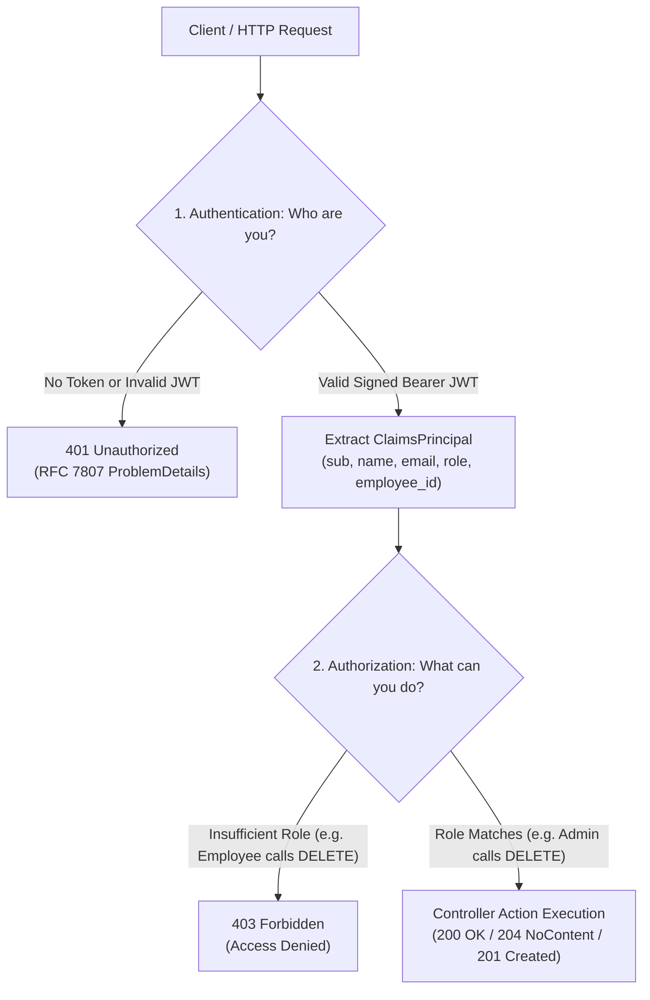
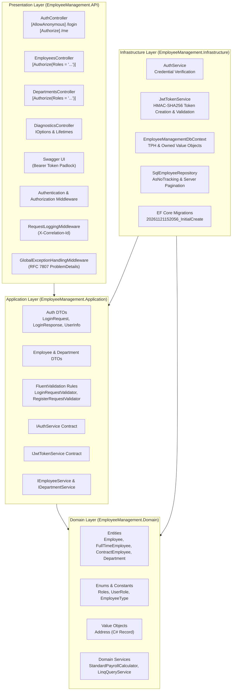

# Day 10 & Gate 2 Assessment: Security, JWT Authentication & Capstone Checkpoint

**Capstone Domain:** Employee & Department Management System  
**Framework:** .NET 8.0 (C# 12 / ASP.NET Core)  
**Author:** Shanmukha-Sai (<kalugurisai2002@gmail.com>)  
**Status:** **GATE 2 PASSED (Week 2 Complete — 153 / 153 Tests Passing)**

---

## 1. Executive Summary & Gate 2 Milestone

Day 10 represents the **Gate 2 Capstone Assessment Checkpoint** — marking the successful completion of **Week 2: Enterprise ASP.NET Core Web API Architecture**.

Over the course of Week 2 (Days 6–10), the application evolved from raw domain services into a production-grade, multi-tier enterprise Web API with full database persistence, server-side pagination, centralized RFC 7807 error handling, and robust JSON Web Token (JWT) role-based security.

```
       ┌─────────────────────────────────────────────────────────────┐
       │                   WEEK 2 ROADMAP PROGRESS                    │
       ├──────────────┬──────────────────────────────────────────────┤
       │ Day 6 (Done) │ ASP.NET Core REST API & Swagger UI           │
       │ Day 7 (Done) │ DI Lifetimes & RequestLoggingMiddleware      │
       │ Day 8 (Done) │ Layered Architecture, FluentValidation & RFC │
       │ Day 9 (Done) │ EF Core 8.0, SQL Migrations & TPH Mapping    │
       │ Day 10(Done) │ JWT Security, RBAC & Gate 2 Assessment      │
       └──────────────┴──────────────────────────────────────────────┘
```

---

## 2. Security Architecture: Authentication vs. Authorization



### Authentication vs. Authorization Distinction

| Concept | Primary Question | Mechanism in ASP.NET Core | HTTP Status on Failure |
| :--- | :--- | :--- | :--- |
| **Authentication (AuthN)** | *"Who are you?"* | `JwtBearerHandler`, token validation parameters (signature, issuer, audience, expiration) | **`401 Unauthorized`** |
| **Authorization (AuthZ)** | *"What are you allowed to do?"* | `[Authorize(Roles = ...)]`, Policy-based requirement evaluation | **`403 Forbidden`** |

---

## 3. JWT Anatomy & Claims Packaging

Every token issued by `POST /api/auth/login` uses cryptographic **HMAC-SHA256** symmetric signing with strict expiration and standard RFC 7519 claims:

### Token Components:
1. **Header:**
   ```json
   {
     "alg": "HS256",
     "typ": "JWT"
   }
   ```
2. **Payload (Claims Identity):**
   ```json
   {
     "sub": "admin",
     "jti": "b4e87943-7f2e-4b2e-a59e-e8bfdc3541c8",
     "http://schemas.xmlsoap.org/ws/2005/05/identity/claims/nameidentifier": "admin",
     "http://schemas.xmlsoap.org/ws/2005/05/identity/claims/name": "admin",
     "http://schemas.xmlsoap.org/ws/2005/05/identity/claims/emailaddress": "admin@company.com",
     "http://schemas.microsoft.com/ws/2008/06/identity/claims/role": "Admin",
     "employee_id": "1",
     "exp": 1732230000,
     "iss": "EmployeeManagementApi",
     "aud": "EmployeeManagementClients"
   }
   ```
3. **Signature:**
   $$\text{HMACSHA256}(\text{base64Url}(Header) + "." + \text{base64Url}(Payload), SecretKey)$$

---

## 4. Role-Based Access Control (RBAC) Matrix

We established three distinct authorization tiers:

| Endpoint | Method | Required Role | Unauthenticated | Employee Role | Manager Role | Admin Role |
| :--- | :---: | :--- | :---: | :---: | :---: | :---: |
| `/api/auth/login` | `POST` | `[AllowAnonymous]` | ✅ 200 | ✅ 200 | ✅ 200 | ✅ 200 |
| `/api/auth/me` | `GET` | Authenticated | ❌ 401 | ✅ 200 | ✅ 200 | ✅ 200 |
| `/api/employees` | `GET` | Authenticated | ❌ 401 | ✅ 200 | ✅ 200 | ✅ 200 |
| `/api/employees/paged` | `GET` | Authenticated | ❌ 401 | ✅ 200 | ✅ 200 | ✅ 200 |
| `/api/employees/{id}` | `GET` | Authenticated | ❌ 401 | ✅ 200 | ✅ 200 | ✅ 200 |
| `/api/employees` | `POST` | `Admin,Manager` | ❌ 401 | ❌ 403 | ✅ 201 | ✅ 201 |
| `/api/employees/{id}` | `PUT` | `Admin,Manager` | ❌ 401 | ❌ 403 | ✅ 204 | ✅ 204 |
| `/api/employees/{id}/salary`| `PATCH`| `Admin` only | ❌ 401 | ❌ 403 | ❌ 403 | ✅ 200 |
| `/api/employees/{id}` | `DELETE`| `Admin` only | ❌ 401 | ❌ 403 | ❌ 403 | ✅ 204 |
| `/api/departments` | `GET` | Authenticated | ❌ 401 | ✅ 200 | ✅ 200 | ✅ 200 |
| `/api/departments/{id}` | `GET` | Authenticated | ❌ 401 | ✅ 200 | ✅ 200 | ✅ 200 |
| `/api/departments` | `POST` | `Admin` only | ❌ 401 | ❌ 403 | ❌ 403 | ✅ 201 |
| `/api/departments/{id}/payroll` | `GET` | `Admin,Manager` | ❌ 401 | ❌ 403 | ✅ 200 | ✅ 200 |

### Pre-Seeded Test Accounts

| Username | Password | Assigned Role | Employee ID | Permissions |
| :--- | :--- | :--- | :---: | :--- |
| `admin` | `Admin@123` | **`Admin`** | 1 | Full administrative control (CRUD, salary modification, department creation) |
| `manager` | `Manager@123` | **`Manager`** | 2 | Staff management (create & edit employees, view department payrolls) |
| `employee` | `Employee@123` | **`Employee`** | 3 | Read-only access across employees and department directories |

---

## 5. Clean 3-Tier Layered Architecture Diagram



---

## 6. Gate 2 Assessment Checklist

| Area | Milestone Criteria | Status | Implementation Evidence |
| :--- | :--- | :---: | :--- |
| **REST API Design** | Resource-based routing, HTTP verbs (GET, POST, PUT, PATCH, DELETE), status codes | **PASS** | `EmployeesController`, `DepartmentsController`, `AuthController` |
| **Swagger / OpenAPI** | Interactive API exploration + JWT Bearer security padlock UI | **PASS** | `builder.Services.AddSwaggerGen` with `SecuritySchemeType.Http` Bearer |
| **Dependency Injection** | Clear demonstration of Transient, Scoped, Singleton lifetimes | **PASS** | `OperationService`, `DiagnosticsController` (`/api/diagnostics/lifetimes`) |
| **Middleware Pipeline** | Request tracking correlation IDs and response execution timers | **PASS** | `RequestLoggingMiddleware` (`X-Correlation-Id`, `X-Response-Time-Ms`) |
| **Layered Architecture** | Clean 3-Tier separation (API, Application, Infrastructure, Domain) | **PASS** | Thin controllers delegating strictly to application services |
| **Validation** | Rich declarative validation decoupled from controllers | **PASS** | FluentValidation: `LoginRequestValidator`, `CreateEmployeeRequestValidator` |
| **Exception Handling** | Centralized exception handling mapped to standard RFC 7807 ProblemDetails | **PASS** | `GlobalExceptionHandlingMiddleware` handling `ValidationException`, `NotFoundException`, `UnauthorizedAccessException` |
| **Data Persistence** | EF Core 8.0 DbContext, TPH discriminator, Owned types, Migrations | **PASS** | `EmployeeManagementDbContext`, `SqlEmployeeRepository`, `20261121152056_InitialCreate` |
| **Query Performance** | `AsNoTracking()`, server-side pagination (`Skip/Take`), sorting and filtering | **PASS** | `SqlEmployeeRepository.GetPagedAsync`, `/api/employees/paged` |
| **Security & Auth** | JWT token generation, role-based authorization (Admin, Manager, Employee) | **PASS** | `JwtTokenService`, `AuthService`, `[Authorize(Roles = ...)]` |
| **Quality & Tests** | Comprehensive test coverage across Domain, App, Infra, and Security | **PASS** | **153 / 153 Tests Passing (0 Failures, 100% Pass Rate)** |

---

## 7. Verification Guide: Testing Gate 2

### 1. Execute Automated Test Suite
```powershell
dotnet test D:\sai\dotnet\EmployeeManagement.sln --logger:console -m:1
```
**Output:**
```text
Passed!  - Failed: 0, Passed: 153, Skipped: 0, Total: 153, Duration: 708 ms - EmployeeManagement.UnitTests.dll (net8.0)
```

### 2. Interactive Testing via `.http` File
Open [EmployeeManagement.API.http](file:///D:/sai/dotnet/src/EmployeeManagement.API/EmployeeManagement.API.http) in VS Code or Visual Studio:
1. Run **Request #1 (POST /api/auth/login)** with `"username": "admin"`, `"password": "Admin@123"` — generates `@adminToken`.
2. Run **Request #5 (GET /api/auth/me)** with `Authorization: Bearer {{adminToken}}` — returns current admin claims.
3. Run **Request #6 (GET /api/employees)** without token — verifies **401 Unauthorized**.
4. Run **Request #7 (DELETE /api/employees/1)** with `{{employeeToken}}` — verifies **403 Forbidden**.
5. Run **Request #16 (DELETE /api/employees/2)** with `{{adminToken}}` — verifies **204 NoContent**.

### 3. Interactive Testing via Swagger UI
1. Run `dotnet run --project src/EmployeeManagement.API`.
2. Navigate to `http://localhost:5200`.
3. Click the green **Authorize** button at the top right.
4. Call `POST /api/auth/login`, copy the `token` value, and paste it into Swagger as `Bearer <token>` or `<token>`.
5. Execute protected endpoints with full role-enforced security!
